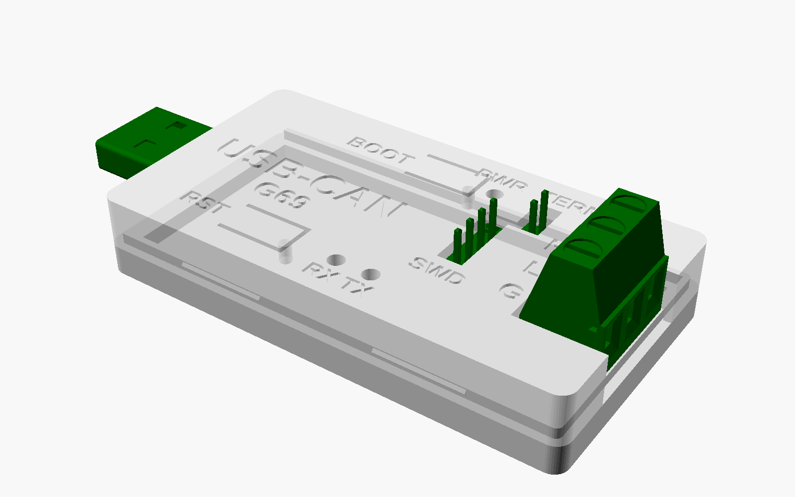
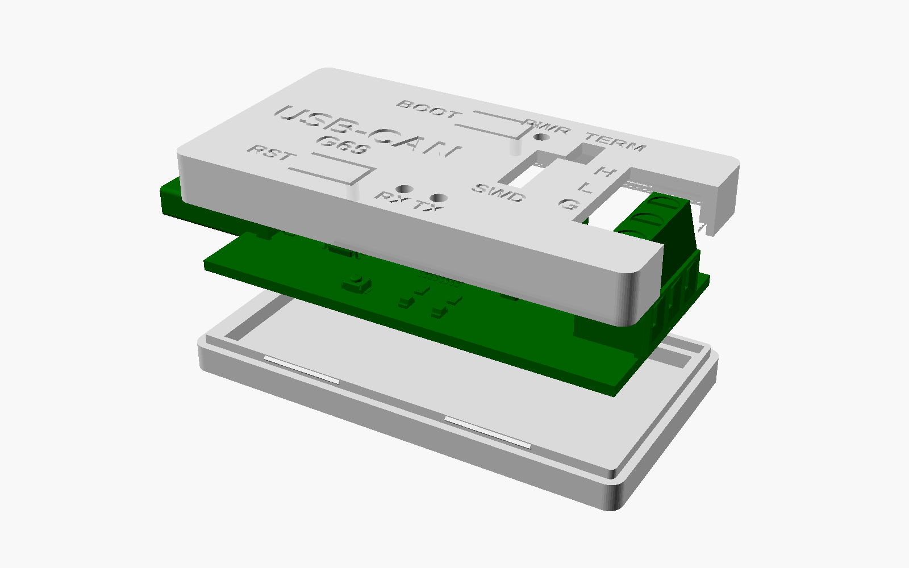

# Boîtier imprimé de l'adaptateur USB-CAN (v0.2)

Boîtier en deux coques pour la carte 60 × 30 mm, au format d'une grosse clé USB :
64 × 34,4 × 10,7 mm, la fiche USB-A dépasse de 12,9 mm à l'avant, le bornier CAN sort à l'arrière.




| Fichier | Contenu |
|---|---|
| `boitier.scad` | modèle paramétrique OpenSCAD (toutes les cotes en tête de fichier) |
| `fond.stl`, `capot.stl` | pièces prêtes à trancher, déjà orientées pour l'impression |
| `boitier_X1C_PLA.3mf` | projet Bambu Studio : Bambu Lab X1 Carbon, buse 0,4, PLA Basic, 0,20 mm |
| `boitier_X1C_PLA_plateau_texture_PEI.gcode` | G-code prêt pour la X1C du FabLab, plateau texturé PEI |
| `boitier_X1C_PLA_plateau_cool_plate.gcode` | même chose pour un plateau lisse « Cool Plate » |

## Au FabLab ENSEA (Bambu Lab X1 Carbon)

1. Badge d'impression 3D (formation FabLab), ou impression sous la surveillance d'un facilitateur.
2. Remplir le ticket machine et le faire signer par un facilitateur.
3. Sur l'imprimante, vérifier trois choses : buse de 0,4 mm, PLA chargé, type de plateau installé.
4. Le plus sûr : ouvrir `boitier_X1C_PLA.3mf` dans Bambu Studio, choisir le plateau et le filament réellement
   en place, cliquer sur « Trancher », puis imprimer (réseau ou carte microSD). Sinon, copier sur la microSD
   le G-code du plateau installé et le lancer depuis l'écran de l'imprimante.
5. Récupérer les pièces dès la fin (environ 25 min), puis nettoyer le plateau avant de le remettre.

## Ce qui est accessible boîtier fermé

- **Fiche USB-A** : encoche dans la face avant.
- **Bornier CAN** : il traverse le capot (fenêtre et encoche arrière). Vis par le dessus, fils par l'arrière.
  Repères H, L, G gravés à côté.
- **LED** PWR, RX, TX : trous de 2,2 mm au-dessus.
- **RESET et BOOT0** : deux languettes souples dans le capot, avec un doigt qui appuie sur le bouton.
- **SWD (J3) et terminaison 120 Ω (JP1)** : les broches sortent par une fenêtre. Un connecteur Dupont
  ou le cavalier s'enfoncent jusqu'à l'embase.

## Impression

- Matière : PLA (195–210 °C), conformément au cours : facile à imprimer. Le PLA se déforme vers 60 °C ;
  pour un usage en voiture au soleil, choisir du PETG.
- **Sans support, sans bordure** : le fond se pose sur son plancher et le capot sur son dessus. Les gravures
  sont sur les faces posées sur le plateau ; seules les lettres font de petits ponts de moins de 1 mm.
- Profil utilisé : 0,20 mm, 3 périmètres, 20 % de remplissage. Environ 25 min et 11 g pour les deux pièces sur X1C.
- **Autre imprimante** : rouvrir `fond.stl` et `capot.stl` dans le trancheur de l'imprimante (Bambu Studio,
  OrcaSlicer, PrusaSlicer), choisir son profil et la matière, puis trancher à nouveau. Le modèle ne change pas :
  il tient sur n'importe quel plateau. Le 3MF fourni ne convient qu'à une X1C.

## Montage

1. Poser la carte dans le fond : elle repose sur le rebord intérieur, composants du dos vers le bas.
2. Présenter le capot, fiche USB dans l'encoche avant et bornier dans la fenêtre arrière.
3. Presser : la jupe du capot passe sur les bossages de la lèvre et s'encliquette. Les nervures du capot
   plaquent la carte.
4. Pour ouvrir : glisser une lame plate dans le joint, côté bornier.

## Réglages si l'ajustement ne convient pas

Les jeux sont des variables en tête de `boitier.scad` :

| Problème | Variable | Valeur actuelle |
|---|---|---|
| La carte force dans le fond | `jeu_carte` | 0,2 mm par côté |
| Le capot ne ferme pas, ou ferme trop fort | `clip_saillie` / `jeu_coques` | 0,35 / 0,15 mm |
| La carte bouge une fois fermé | `serrage` | 0,05 mm |
| Le bouton reste enfoncé / ne s'enfonce pas | `jeu_doigt` | 0,15 mm |
| Le bornier choisi est plus large | `bornier`, `jeu_bornier` | 21,1–30,9 × −8,36–7,62 mm, 0,4 mm |

Puis régénérer les pièces :

```
openscad --export-format binstl -D "piece=\"fond\""  -o fond.stl  boitier.scad
openscad --export-format binstl -D "piece=\"capot\"" -o capot.stl boitier.scad
```

## Origine des cotes

Positions et hauteurs relevées sur `adaptateur_usb_can.kicad_pcb` et sur les modèles 3D KiCad des composants :

| Élément | Mesure | Conséquence |
|---|---|---|
| Fiche USB-A (J1) | blindage 12,06 × 4,5 mm, de z = 0,34 à 4,84 | plafond intérieur à 5,2 mm |
| Bornier (J2) | 13,8 mm au-dessus de la carte, déborde de 0,9 mm | traverse le capot |
| Barrettes J3, JP1 | 8,5 mm | traversent le capot |
| CH340C, boutons, quartz, LED | 1,1 à 1,75 mm | sous le plafond |
| Dos : SOT-223, tantale, broches traversantes | jusqu'à 1,91 mm sous la carte | plancher intérieur à 2,3 mm |

Les vues avec la carte se refont à partir de son export 3D :

```
kicad-cli pcb export stl --subst-models --user-origin 130x115mm -o carte.stl ../adaptateur_usb_can.kicad_pcb
openscad -D "piece=\"ensemble\"" -D "carte_stl=\"carte.stl\"" -o vue_montee.png boitier.scad
```

À vérifier à la première impression : la fiche USB doit entrer à fond dans un port de PC avant que le
boîtier ne touche. 12,9 mm dépassent, pour environ 12 mm d'enfoncement dans une prise standard.
