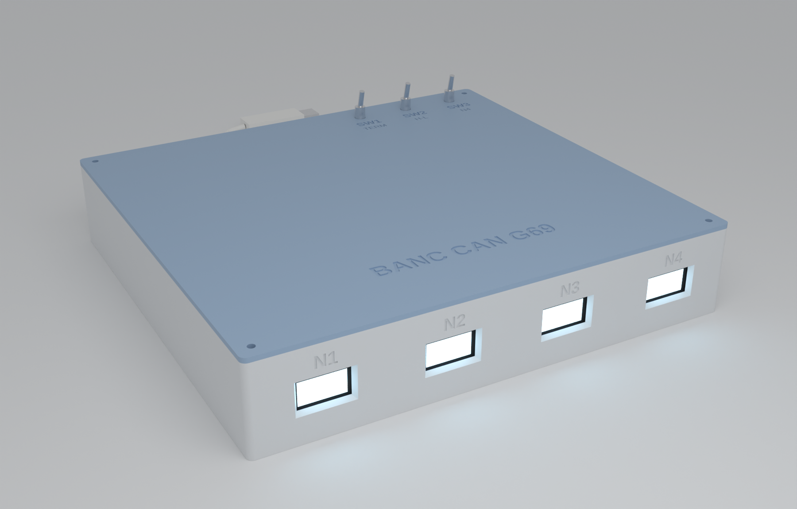
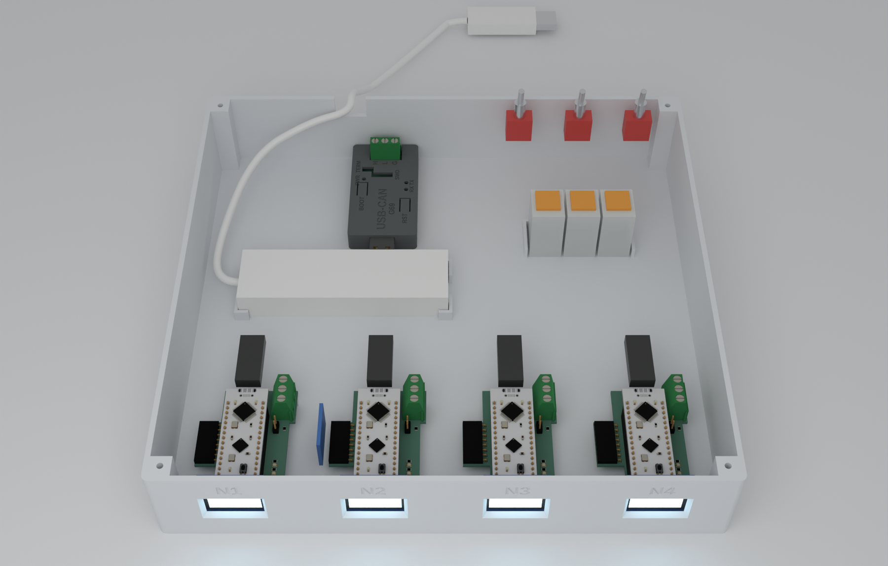
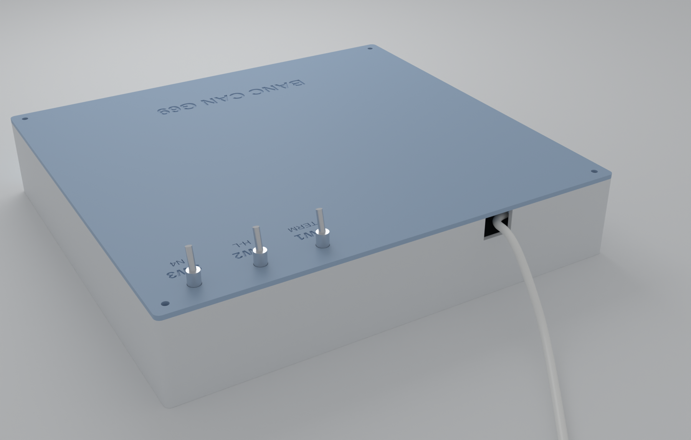
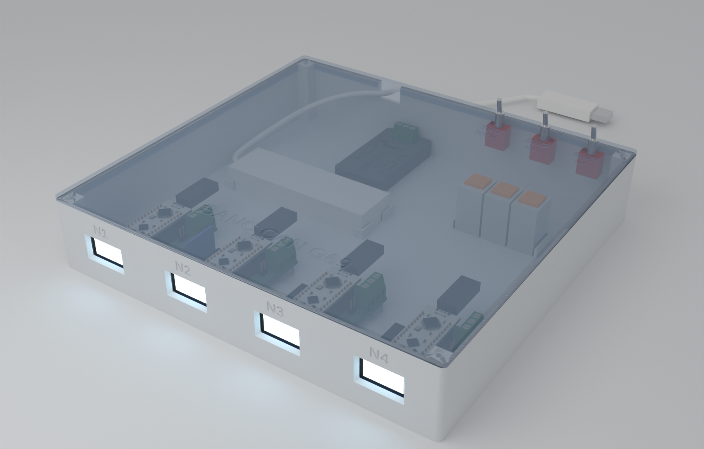

# Boîte imprimée du banc CAN

Boîte en deux pièces (bac et couvercle) qui enferme tout le banc : les 4 nœuds sur leur
carte porteuse v0.3, le hub USB, l'adaptateur USB-CAN v0.2 et le câblage. Fermée, elle ne
laisse voir que les 4 écrans OLED en façade et les 3 leviers de faute SW1 à SW3 sur le dessus.

Dimensions extérieures : **240,8 × 224,8 × 46,4 mm**. Elle tient sur le plateau de la
Bambu Lab X1 Carbon du FabLab (256 × 256 mm).






| Fichier | Contenu |
|---|---|
| `boitier_banc.scad` | modèle paramétrique OpenSCAD, toutes les cotes en tête de fichier |
| `bac.stl`, `couvercle.stl` | pièces orientées pour l'impression, sans support |
| `previsualisation.py` | rendus Blender `preview_*.png` avec les modèles réels (carte porteuse exportée du PCB, Nucleo, adaptateur) ; écrans, hub, Wago et interrupteurs en volumes simples |
| `pieces_a_imprimer.png` | les deux pièces seules |

## Ce que contient la boîte

- **4 cartes porteuses** côte à côte, au pas de 58 mm, écran OLED contre la façade. Chacune
  se visse sur deux entretoises de 6 mm (H1, H2, vis M3 dans le plastique) ; un appui
  soutient le coin du bornier.
- **Zone des câbles** derrière les cartes : 36 mm pour les fiches micro-USB des Nucleo et le
  bus en pieuvre.
- **Hub USB** à plat à l'arrière, tenu par deux butées aux bouts : ses grands côtés restent
  libres pour les ports latéraux. **L'adaptateur USB-CAN** s'enfiche directement dans un port
  du hub, côté arrière, comme le ZLG aujourd'hui.
- **Jonction du bus** : cadre pour trois bornes Wago 221-420 debout, à droite derrière les cartes.
- **SW1, SW2, SW3** sur le couvercle, à l'arrière droit, avec leur repère gravé.
- **Sortie des câbles** : encoche de 16 × 12 mm dans la paroi arrière. Le seul câble USB qui
  sort est celui du hub : il donne accès aux 4 ST-LINK (programmation, journaux) et à
  l'adaptateur USB-CAN. L'alimentation du hub passe par la même encoche.
- **Fermeture vissée** : 4 vis M3 dans les colonnes des coins, aucun clip.

## À vérifier avant d'imprimer

| Point | Hypothèse du modèle | Variable |
|---|---|---|
| Hub HQ Power HQM121C | 100 × 30 × 15 mm d'après des revendeurs ; **longueur à mesurer**, il paraît plus long en photo | `hub`, `hub_pos` |
| Place autour du hub | 28 mm devant, 78 mm derrière (adaptateur enfiché) | `prof_arriere`, `hub_pos` |
| Interrupteurs | pas encore choisis : trous de 6,2 mm (canon de 6 mm, type MTS-102) | `d_inter`, `inter_x`, `inter_y` |
| Fenêtre des écrans | 24 × 13 mm, placée d'après le verre du module, pas d'après la zone allumée | `fen_l`, `fen_h`, `fen_z0` |

Les cotes des cartes viennent de `../carte_porteuse/generate_pcb.py` et de
`../carte_porteuse/verification/encombrement.py`.

## Impression et montage

- PLA, 0,20 mm, sans support. Le bac se pose sur son plancher, le couvercle sur son dessus.
- Visser les cartes, enficher Nucleo, OLED et MPU-6050, câbler, puis fermer le couvercle
  avec 4 vis M3 × 10 dans les colonnes des coins.

## Régénérer

```
openscad --export-format binstl -D "piece=\"bac\""       -o bac.stl       boitier_banc.scad
openscad --export-format binstl -D "piece=\"couvercle\"" -o couvercle.stl boitier_banc.scad
```
