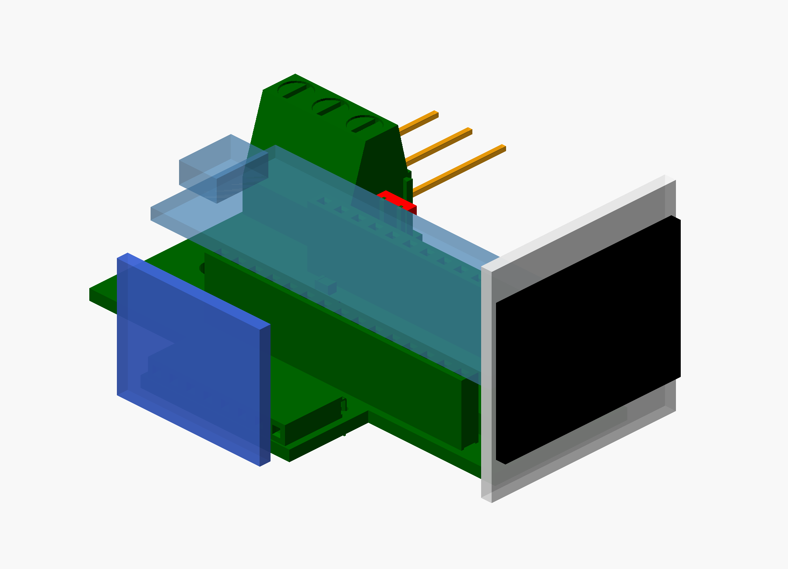

# Carte porteuse d'un nœud du banc CAN (v0.3)

Une Nucleo-G431KB s'enfiche dessus. La carte porte le transceiver TJA1051T/3 et ses
découplages, un bornier qui raccorde le nœud au bus, la terminaison 120 Ω sur cavalier,
l'écran OLED, le MPU-6050 (N2) et deux LED d'état.
Plus aucun fil Dupont. À fabriquer en 4 exemplaires.

**v0.3 (24/11/2026)** : un seul bornier au lieu de deux. Avec une entrée et une sortie sur
chaque carte, la paire torsadée était coupée et détorsadée à chaque nœud, et le bus
traversait les quatre cartes. Le nœud est maintenant une dérivation courte d'une paire
torsadée continue (voir « Raccordement au bus »), comme le prévoient le dossier et
[pinout.md](../../docs/pinout.md) §6. Le coin arrière gauche libéré a été retiré.

## Disposition (vue de dessus, arrière en haut)

| Zone | Contenu |
|---|---|
| Bande arrière | bornier du bus à droite (fils vers la droite), fixation M3 H1 |
| Colonne centrale | barrettes de la Nucleo, posée dans la profondeur, **USB vers l'arrière** (câble vers le hub) ; sous elle, le TJA1051, ses 100 nF, les résistances et la fixation H2 ; barrette coudée de l'OLED au bord avant |
| Gauche | barrette coudée du MPU-6050 : le module tient debout au-delà du bord |
| Droite | cavalier TERM, LED **B** (bus-off, jaune) et **E** (erreur, rouge) |

Contour en escalier : 1 830 mm² au lieu de 3 250 mm² pour la v0.1 rectangulaire (−44 %).

## Raccordement au bus

Le bus est une « pieuvre » de câbles : une paire torsadée CAN_H / CAN_L continue, du ZLG
USBCAN-UC12 jusqu'à N4, accompagnée du fil de masse, avec une dérivation courte soudée et
gainée vers chaque nœud. La paire n'est ni coupée ni détorsadée entre deux nœuds.

- Chaque dérivation arrive sur le bornier J1 : de l'arrière vers l'avant **H, L, G**
  (sérigraphie « BUS H-L-G »). La garder torsadée et la plus courte possible (≤ 0,3 m).
- Deux terminaisons seulement, aux extrémités de la paire : l'interrupteur 120 Ω du ZLG et
  le cavalier TERM de N4, placé en bout de ligne. Pas de cavalier sur N1, N2 et N3.
- Contrôle hors tension : environ 60 Ω entre CAN_H et CAN_L ([pinout.md](../../docs/pinout.md) §6).
- Fil : le bornier MKDS 1,5 est donné pour 0,2 à 2,5 mm². Un fil Dupont (0,08 à 0,13 mm²)
  est trop fin pour être serré sans embout.

## Montage

1. Souder les CMS (U1, C1, C2, R1, R2, R3, R7, R9, R10, D1, D2), puis les barrettes et les borniers.
2. R9 et R10 (0 Ω) alimentent l'OLED, dont les broches sont dans l'ordre GND, VCC, SCL, SDA
   (modules reçus). Les variantes R11/R12 (OLED en VCC/GND) et la barrette capteurs J8 ont été
   retirées le 17/11/2026.
3. Visser la carte sur la plaque du banc (H1, H2, vis M3), **puis** enficher la Nucleo :
   broche 1 de CN3 et CN4 côté USB, flèche « ^ USB ».
4. L'OLED s'enfiche à l'horizontale dans sa barrette coudée et tient debout, à l'envers :
   le firmware retourne l'affichage. Le MPU-6050 de même, sur N2.
5. Cavalier TERM sur le nœud en bout de ligne seulement (N4 : câble vers l'interrupteur SW1).

Non montés : R8 (S sur PB6), R4/R5 (tirages I2C, les modules ont les leurs). PA4 et PA7
(capteurs Hall et 1-Wire, reportés) restent libres sur la Nucleo.

## Vérifications

**Électrique** : ERC 0 ; DRC 0 erreur, 0 liaison manquante, 0 écart avec le schéma ; restent
76 avertissements de sérigraphie (contours des barrettes coudées et du bornier qui touchent
volontairement le bord, repères qui se touchent).

**Encombrements** (`verification/encombrement.py`, sur l'export 3D KiCad) : aucun conflit entre
les modules enfichés (Nucleo et sa fiche USB, OLED debout, MPU-6050 debout, fils du bornier,
cavalier, têtes de vis M3) et les composants. Sous la Nucleo (fond à 10,5 mm),
le plus haut est le corps de la barrette OLED (4,1 mm). Le script lit un fichier
`c_<repère>.stl` par composant (`kicad-cli pcb export stl --subst-models --user-origin 100x100mm
--component-filter <repère>`). Vue : `openscad verification/assemblage.scad` après
`kicad-cli pcb export stl --subst-models --user-origin 100x100mm -o verification/carte.stl carte_porteuse.kicad_pcb`.

**Solidité** : largeur minimale 19,6 mm ; les parties latérales sont rattachées au corps sur
toute leur longueur (22 et 28 mm) ; quatre angles rentrants ; le bornier est sur la bande
arrière, pleine sur 32,7 mm de large ; les deux vis M3 sont entre les barrettes de la Nucleo,
là où s'exerce l'effort d'enfichage. La plaque du banc devra soutenir le coin arrière droit,
sous le bornier, où l'on serre les vis.

**Cours PCB (option Maker)** :

| Règle du cours | Sur la carte |
|---|---|
| Contraintes mécaniques et fixations d'abord | 2 trous M3 de 3,2 mm (admis par la factory), placés en premier |
| Connecteurs au bord, câbles vers l'extérieur | bornier au bord droit, USB vers l'arrière, modules debout au-delà des bords |
| Microcontrôleur au centre, composants près de leurs broches | Nucleo au centre ; LED près de PA0/PA1 (CN3), MPU près de l'I2C (CN4) |
| Découplage au plus près | 100 nF à 2,5 mm de VCC et 2,9 mm de VIO |
| Plan de masse | deux faces, masse aussi routée sous la Nucleo ; vias de masse superflus retirés (`../elaguer_vias.py`), puis vias de couture posés à la main : 21 vias au total. Relancer `route_freerouting.py` remettrait les vias automatiques |
| Classes de nets, pistes larges pour l'alimentation | classe Puissance : +5V et +3V3 en 0,6 mm, signaux en 0,4 mm |
| Teardrops | 83 |
| Champ MPN dans les symboles | 20 composants renseignés |
| ERC et DRC propres | voir plus haut |
| Règles factory | piste 0,4 mm, isolation 0,3 mm, vias 0,8/0,4 mm, 0,5 mm au contour, 0805 HandSolder |
| Le plus petit possible, pas de gaspillage | contour découpé ; seules les barrettes de la Nucleo ont des broches inutilisées (elles la tiennent) |

À confirmer avec la factory : la découpe d'un contour non rectangulaire (angles rentrants).

## Régénérer

`generate_schematic.py` → `generate_pcb.py` → `route_freerouting.py <freerouting.jar>` →
teardrops dans l'éditeur de PCB (Éditer > Éditer Teardrops) → `generate_fabrication.py`
(depuis PowerShell) → `generate_commande.py`.

`generate_pcb.py` repart d'une carte vide : le relancer efface le routage. Les retouches
du 17/11 (retrait de R11, R12, J8) et du 24/11 (un seul bornier, coin rogné) ont été faites
sur la carte routée, sans rerouter ; `generate_pcb.py` décrit le placement et le contour
qui en résultent.
