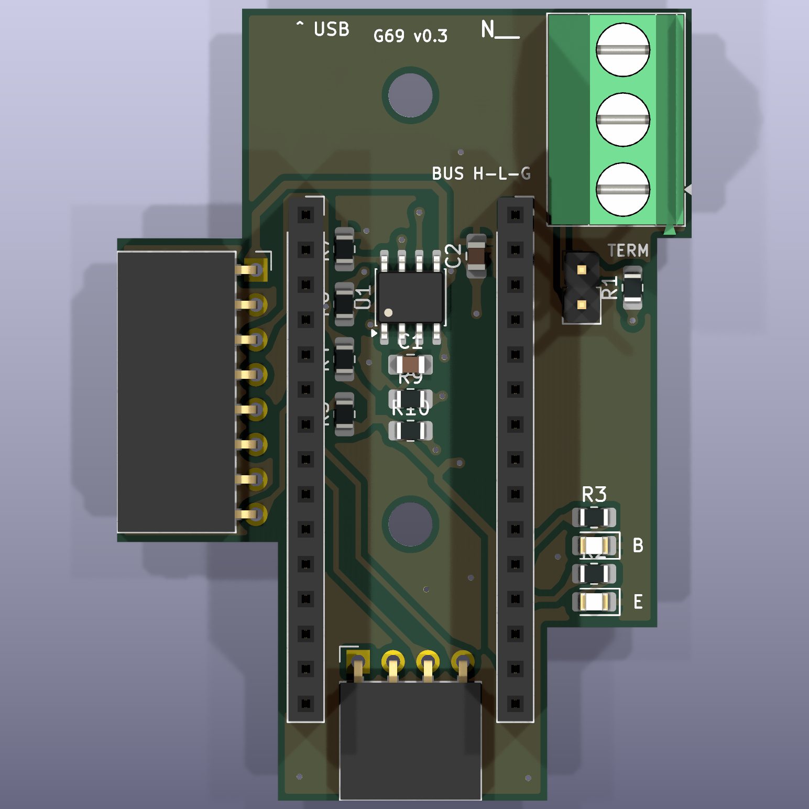

# Carte porteuse d'un nœud du banc CAN (v0.4)

Une Nucleo-G431KB s'enfiche dessus. La carte porte le transceiver TJA1051T/3 et ses
découplages, un bornier qui raccorde le nœud au bus, la terminaison 120 Ω sur cavalier,
l'écran OLED, le MPU-6050 (N2) et deux LED d'état.
Plus aucun fil Dupont. À fabriquer en 4 exemplaires.

**v0.4 (25/11/2026)** : routage repris après les remarques du cours d'électronique, sans
changer le schéma, le contour, les fixations ni la place des connecteurs. Le TJA1051 est monté
de 8 mm vers le bornier et tourné d'un quart de tour : CANH et CANL vont au bornier côte à
côte sur la face avant, sans via, en 15 mm (31 et 25 mm sur deux faces avant). La face
arrière redevient un plan de masse d'un seul tenant (28 mm de pistes en cinq ponts au lieu
de 245 mm), relié à la face avant par 43 vias au lieu de 9. Le routage est écrit en
coordonnées dans `router_manuel.py` ; Freerouting n'est plus utilisé. Le bornier est percé à
1,4 mm (pas de la factory), une lettre H, L, G repère chaque borne, et rien d'autre que la
masse ne passe à moins de 1 mm des têtes de vis. Le schéma n'a pas changé électriquement ;
son cartouche et `fabrication/schema.pdf` passent en révision 0.4 pour suivre la carte.

**v0.3 (24/11/2026)** : un seul bornier au lieu de deux. Avec une entrée et une sortie sur
chaque carte, la paire torsadée était coupée et détorsadée à chaque nœud, et le bus
traversait les quatre cartes. Le nœud est maintenant une branche courte, torsadée jusqu'au
bornier, qui rejoint un point de jonction commun (voir « Raccordement au bus »). Le coin
arrière gauche libéré a été retiré.

## Disposition (vue de dessus, arrière en haut)

| Zone | Contenu |
|---|---|
| Bande arrière | bornier du bus à droite (fils vers la droite), fixation M3 H1 |
| Colonne centrale | barrettes de la Nucleo, posée dans la profondeur, **USB vers l'arrière** (câble vers le hub) ; sous elle, le TJA1051 en haut, tourné vers le bornier, ses 100 nF, les résistances et la fixation H2 ; barrette coudée de l'OLED au bord avant |
| Gauche | barrette coudée du MPU-6050 : le module tient debout au-delà du bord |
| Droite | cavalier TERM, LED **B** (bus-off, jaune) et **E** (erreur, rouge) |

Contour en escalier : 1 830 mm² au lieu de 3 250 mm² pour la v0.1 rectangulaire (−44 %).

## Raccordement au bus

Le bus est une « pieuvre » : chaque nœud et le ZLG USBCAN-UC12 sont reliés par une branche
courte à un point de jonction commun, fait de **trois bornes Wago 221-420** (10 entrées à
leviers, toutes reliées entre elles) : une pour CAN_H, une pour CAN_L, une pour la masse.
Cinq entrées sont prises par ligne (ZLG et N1 à N4), cinq restent libres pour un nœud
partenaire ou une sonde.

- Chaque branche arrive sur le bornier J1 : de l'arrière vers l'avant **H, L, G**
  (une lettre en face de chaque borne, contre le dos du bornier, côté Nucleo).
- Fil souple de câblage en trois couleurs, de 0,2 à 0,5 mm² : CAN_H et CAN_L torsadés
  ensemble à la main (un tour tous les 1 à 2 cm) du Wago jusqu'au bornier, la masse à côté.
  Le bornier MKDS 1,5 est donné pour 0,2 à 2,5 mm² et le Wago 221-420 pour 0,14 à 4 mm² en
  fil souple ; un fil Dupont (0,08 à 0,13 mm²) est trop fin pour les deux.
- C'est une étoile et non une ligne : garder les branches courtes (≤ 0,3 m) et de longueurs
  proches.
- Deux terminaisons de 120 Ω seulement : l'interrupteur du ZLG et le cavalier TERM de N4
  (câblé vers SW1). Pas de cavalier sur N1, N2 et N3.
- Contrôle hors tension : environ 60 Ω entre CAN_H et CAN_L ([pinout.md](../../docs/pinout.md) §6).

À commander pour le banc : 3 Wago 221-420 et du fil souple en trois couleurs.

## Montage

1. Souder les CMS dans cet ordre : **U1 d'abord**, puis C1, C2 et R7 qui l'entourent (C1 est
   à 0,9 mm des pattes 1 à 4 de U1 : contrôler à la loupe qu'aucun pont ne les relie), puis
   R1, R2, R3, R9, R10, D1, D2. Ensuite seulement les barrettes et le bornier : U1, C1, C2 et
   R7 sont entre les barrettes et le bornier, le fer n'y passe plus après. Le cuivre est nu :
   après soudure, vérifier à la loupe l'absence de pont entre les pastilles de CN3/CN4 et les
   pistes qui les longent (0,37 mm au plus serré).
2. R9 et R10 (0 Ω) alimentent l'OLED, dont les broches sont dans l'ordre GND, VCC, SCL, SDA
   (modules reçus). Les variantes R11/R12 (OLED en VCC/GND) et la barrette capteurs J8 ont été
   retirées le 17/11/2026.
3. Visser la carte sur la plaque du banc (H1, H2, vis M3 à tête de 5,5 mm, sans rondelle
   métallique plus large : la tête repose sur le plan de masse, et les pistes les plus proches
   sont à 1,05 mm de la tête de H1 et 1,47 mm de celle de H2), **puis** enficher la Nucleo :
   broche 1 de CN3 et CN4 côté USB, flèche « ^ USB ».
4. L'OLED s'enfiche à l'horizontale dans sa barrette coudée et tient debout, à l'envers :
   le firmware retourne l'affichage. Le MPU-6050 de même, sur N2.
5. Cavalier TERM sur le nœud en bout de ligne seulement (N4 : câble vers l'interrupteur SW1).

Non montés : R8 (S sur PB6), R4/R5 (tirages I2C, les modules ont les leurs). PA4 et PA7
(capteurs Hall et 1-Wire, reportés) restent libres sur la Nucleo.

## Vérifications

**Électrique** : ERC 0 ; DRC 0 erreur, 0 liaison manquante, 0 écart avec le schéma. Restent
60 avertissements, tous voulus : 59 pour les contours des barrettes coudées et du bornier, qui
dépassent le bord de la carte, et 1 parce que le bornier J1 est percé à 1,4 mm au lieu des
1,3 mm de sa bibliothèque. Plus aucun repère sur une pastille ni sur un autre tracé.
`verifier_criteres.py` relance l'ERC et le DRC et contrôle les critères ci-dessous.

**Routage** (mesuré par `verifier_criteres.py`) :

| Critère | Sur la carte |
|---|---|
| Vias de masse | 43 vias GND (49 vias en tout), grille en quinconce de 6 mm ; aucun cuivre de masse à plus de 7,4 mm d'un via ; un via à 1,2 mm de C1 (entre C1 et la broche GND de U1) et 1,3 mm de C2 |
| Plan de masse | face arrière d'un seul tenant (77 % de la carte), 28 mm de pistes en cinq ponts (SDA 10,4 ; CAN_S 7,9 ; SCL 3,9 ; +5V 3,2 ; CAN_TX 2,4), rien sous U1 ni sous la paire CAN ; face avant : chaque îlot de masse a son via |
| Paire CAN | U1 → bornier sur la face avant, sans via : CANH 14,9 mm, CANL 14,6 mm, côte à côte à 0,35 mm sur 11 mm. Les branches de la terminaison (R1, cavalier) partent des bornes : 16 et 12 mm de plus, imposés par la place du cavalier, qui doit rester accessible Nucleo enfichée |
| Découplage | C1 à 2,7 mm de VCC, C2 à 1,9 mm de VIO |
| Têtes de vis | disque de 7 mm interdit aux pistes et aux vias autour de H1 et H2 (règle du DRC) ; cuivre hors masse le plus proche : 1,05 mm de la tête de H1 (+3V3), 1,47 mm de celle de H2 (SDA) |
| Perçages | 0,4 mm (vias), 1,0 mm (barrettes), 1,4 mm (bornier), 3,2 mm (fixations, valeur du guide de la factory) |

Les cinq ponts de la face arrière sont imposés par le brochage. CN4 et la barrette du MPU-6050
présentent SCL, SDA et INT dans l'ordre inverse : INT passe entre les deux barrettes sur la
face avant, SDA sur la face arrière, SCL fait le tour par le nord de CN4. CAN_TX, CAN_S et
CAN_RX descendent le long de CN4 alors que l'I2C en repart vers l'OLED : SCL et SDA quittent
leur pastille de CN4 par l'arrière, sur 3,9 mm, et CAN_TX y entre de même. CAN_S (option non
montée, R8) passe sous le +3V3 du MPU-6050 par un pont de 7,9 mm, à 2,7 mm des pattes de U1.

Quatre vias de masse sont sous un corps de composant, faute d'autre place à moins de 8 mm :
trois sous la barrette du MPU-6050, dont le corps couvre toute l'aile gauche, et un sous le
bornier. La factory métallise les vias, ils affleurent. S'il fallait un jour les riveter ou
les étamer, retirer ces quatre-là (`coudre_gnd.py` et `verifier_criteres.py` en donnent la
liste) : le cuivre de masse le plus éloigné d'un via serait alors à 14 mm, dans le coin de l'aile gauche.

Le +5V arrive sur la pastille de la broche VCC de U1 par le canal sous le boîtier, et C1 est
branché à l'autre bout de cette pastille, 0,9 mm plus loin. Faire arriver le +5V d'abord sur
C1 demanderait de croiser CAN_TX ou CAN_RX, donc un pont de plus sur la face arrière au pied
de U1 : on a gardé le plan de masse plein.

**Encombrements** (`verification/encombrement.py`, sur l'export 3D KiCad) : aucun conflit entre
les modules enfichés (Nucleo et sa fiche USB, OLED debout, MPU-6050 debout, fils du bornier,
cavalier, têtes de vis M3) et les composants. Sous la Nucleo (fond à 10,5 mm),
le plus haut est le corps de la barrette OLED (4,1 mm). Le script lit un fichier
`c_<repère>.stl` par composant (`kicad-cli pcb export stl --subst-models --user-origin 100x100mm
--component-filter <repère>`). Vue : `openscad verification/assemblage.scad` après
`kicad-cli pcb export stl --subst-models --user-origin 100x100mm -o verification/carte.stl carte_porteuse.kicad_pcb`.

**Solidité** : largeur minimale 19,6 mm ; les parties latérales sont rattachées au corps sur
toute leur longueur (22 et 28 mm) ; quatre angles rentrants ; le bornier est sur la bande
arrière, pleine sur 32,7 mm de large ; les deux vis M3 sont entre les barrettes de la Nucleo,
là où s'exerce l'effort d'enfichage. La plaque du banc devra soutenir le coin arrière droit,
sous le bornier, où l'on serre les vis.

**Cours PCB (option Maker)** :

| Règle du cours | Sur la carte |
|---|---|
| Contraintes mécaniques et fixations d'abord | 2 trous M3 de 3,2 mm (admis par la factory), placés en premier |
| Connecteurs au bord, câbles vers l'extérieur | bornier au bord droit, USB vers l'arrière, modules debout au-delà des bords |
| Microcontrôleur au centre, composants près de leurs broches | Nucleo au centre ; LED près de PA0/PA1 (CN3), MPU près de l'I2C (CN4) |
| Découplage au plus près | 100 nF à 2,7 mm de VCC et 1,9 mm de VIO, un via de masse au pied de chacun |
| Plan de masse | deux faces, la face arrière presque pleine ; aucune piste de masse, 43 vias dont 37 de couture posés par `coudre_gnd.py` |
| Classes de nets, pistes larges pour l'alimentation | classe Puissance : +5V et +3V3 en 0,6 mm (0,5 mm pour le +3V3 le long de CN3, faute de place), signaux en 0,4 mm |
| Teardrops | aucun depuis la v0.4 : ils se posent dans l'éditeur et se perdent à chaque régénération. À remettre avant fabrication si on le souhaite (Éditer > Éditer Teardrops), puis relancer `verifier_criteres.py` et `generate_fabrication.py` |
| Champ MPN dans les symboles | 20 composants renseignés |
| ERC et DRC propres | voir plus haut |
| Règles factory | piste 0,4 mm, isolation 0,3 mm, vias 0,8/0,4 mm, 0,5 mm au contour, perçages au pas de 0,2 mm, 0805 HandSolder |
| Le plus petit possible, pas de gaspillage | contour découpé ; seules les barrettes de la Nucleo ont des broches inutilisées (elles la tiennent) |

À confirmer avec la factory : la découpe d'un contour non rectangulaire (angles rentrants).

## Régénérer

Avec le Python de KiCad (`"C:\Program Files\KiCad\9.0\bin\python.exe"`) :
`generate_pcb.py` (contour, placement, plans de masse : repart d'une carte vide et efface le
routage) → `router_manuel.py` (pistes) → `coudre_gnd.py` (vias de masse) →
`verifier_criteres.py` (ERC, DRC, critères de routage ; code de retour 0 si tout est tenu).
Puis, avec le Python du système : `generate_fabrication.py` → `generate_commande.py`.
La chaîne est déterministe : deux exécutions donnent la même carte.

Le placement est dans `PLACEMENT` (`generate_pcb.py`) et les pistes sont en coordonnées
dans `router_manuel.py` : déplacer un composant oblige à reprendre les pistes qui y arrivent.
`kisym.py` est une copie de `../adaptateur_usb_can/kisym.py`. `generate_schematic.py` réécrit
tout le schéma, mise en page manuelle comprise : ne pas le relancer sans raison.
`route_freerouting.py` (v0.1 à v0.3) n'est plus dans la chaîne ; `../elaguer_vias.py` ne doit
plus être lancé sur cette carte, il retirerait les vias de couture.
