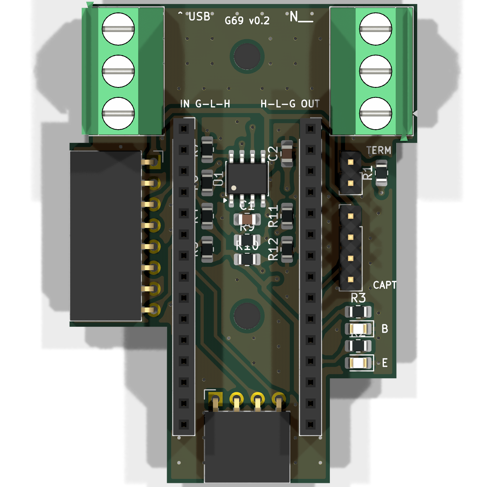
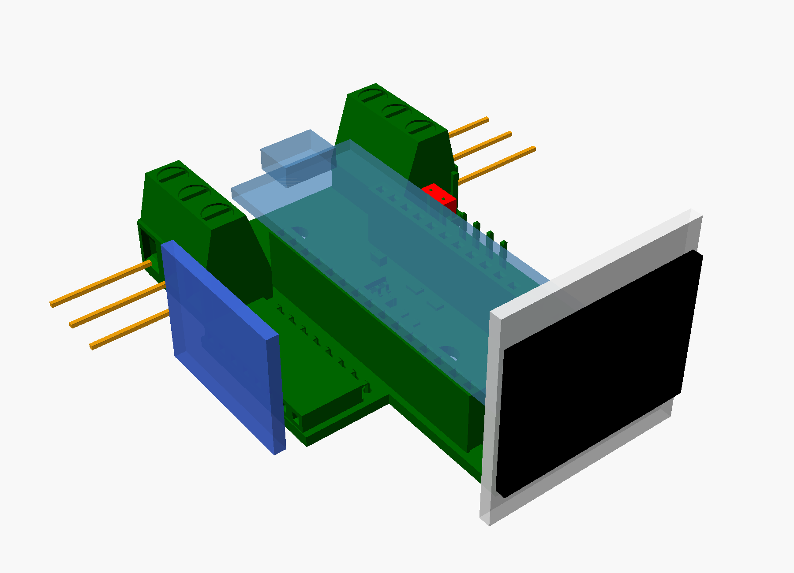

# Carte porteuse d'un nœud du banc CAN (v0.2)

Une Nucleo-G431KB s'enfiche dessus. La carte porte le transceiver TJA1051T/3 et ses
découplages, deux borniers pour chaîner le bus (entrée à gauche, sortie à droite), la
terminaison 120 Ω sur cavalier, l'écran OLED, le MPU-6050 (N2) et deux LED d'état.
Plus aucun fil Dupont. À fabriquer en 4 exemplaires.

## Disposition (vue de dessus, arrière en haut)

| Zone | Contenu |
|---|---|
| Bande arrière | bornier d'entrée (fils à gauche), bornier de sortie (fils à droite), fixation M3 H1 |
| Colonne centrale | barrettes de la Nucleo, posée dans la profondeur, **USB vers l'arrière** (câble vers le hub) ; sous elle, le TJA1051, ses 100 nF, les résistances et la fixation H2 ; barrette coudée de l'OLED au bord avant |
| Gauche | barrette coudée du MPU-6050 : le module tient debout au-delà du bord |
| Droite | cavalier TERM, barrette capteurs (non montée), LED **B** (bus-off, jaune) et **E** (erreur, rouge) |

Contour en escalier : 2 050 mm² au lieu de 3 250 mm² pour la v0.1 rectangulaire (−37 %).

## Montage

1. Souder les CMS (U1, C1, C2, R1, R2, R3, R7, R9, R10, D1, D2), puis les barrettes et les borniers.
2. **Avant R9 et R10 : vérifier l'ordre des broches de l'OLED reçu.** GND puis VCC : R9 et R10.
   VCC puis GND : R11 et R12 à la place. Jamais les quatre.
3. Visser la carte sur la plaque du banc (H1, H2, vis M3), **puis** enficher la Nucleo :
   broche 1 de CN3 et CN4 côté USB, flèche « ^ USB ».
4. L'OLED s'enfiche à l'horizontale dans sa barrette coudée et tient debout, à l'envers :
   le firmware retourne l'affichage. Le MPU-6050 de même, sur N2.
5. Cavalier TERM sur le nœud en bout de bus seulement (N4 : câble vers l'interrupteur SW1).

Non montés : R8 (S sur PB6), R11/R12 (OLED en VCC/GND), R4/R5 (tirages I2C, les modules ont
les leurs), J8 (capteurs Hall et 1-Wire, reportés ; tirage 1-Wire sur le module DS18B20).

## Vérifications

**Électrique** : ERC 0 ; DRC 0 erreur, 0 liaison manquante, 0 erreur d'empreinte ; restent
79 avertissements de sérigraphie (contours des barrettes coudées et des borniers qui touchent
volontairement le bord, repères qui se touchent).

**Encombrements** (`verification/encombrement.py`, sur l'export 3D KiCad) : aucun conflit entre
les modules enfichés (Nucleo et sa fiche USB, OLED debout, MPU-6050 debout, fils des borniers,
cavalier, câble capteurs, têtes de vis M3) et les composants. Sous la Nucleo (fond à 10,5 mm),
le plus haut est le corps de la barrette OLED (4,1 mm). Le MPU-6050 commence 2,7 mm sous les
fils du bornier d'entrée. Vue : `openscad verification/assemblage.scad` après
`kicad-cli pcb export stl --subst-models --user-origin 100x100mm -o verification/carte.stl carte_porteuse.kicad_pcb`.

**Solidité** : largeur minimale 19,6 mm ; les parties latérales sont rattachées au corps sur
toute leur longueur (22 et 45 mm) ; deux angles rentrants seulement, loin des borniers ; les
deux vis M3 sont entre les barrettes de la Nucleo, là où s'exerce l'effort d'enfichage. La
plaque du banc devra soutenir les deux coins arrière, sous les borniers, où l'on serre les vis.

**Cours PCB (option Maker)** :

| Règle du cours | Sur la carte |
|---|---|
| Contraintes mécaniques et fixations d'abord | 2 trous M3 de 3,2 mm (admis par la factory), placés en premier |
| Connecteurs au bord, câbles vers l'extérieur | borniers sur les bords gauche et droit, USB vers l'arrière, modules debout au-delà des bords |
| Microcontrôleur au centre, composants près de leurs broches | Nucleo au centre ; LED près de PA0/PA1 (CN3), MPU près de l'I2C (CN4) |
| Découplage au plus près | 100 nF à 2,5 mm de VCC et 2,9 mm de VIO |
| Plan de masse | deux faces, masse aussi routée sous la Nucleo ; vias de masse superflus retirés (`../elaguer_vias.py`), puis vias de couture posés à la main : 34 vias au total. Relancer `route_freerouting.py` remettrait les vias automatiques |
| Classes de nets, pistes larges pour l'alimentation | classe Puissance : +5V et +3V3 en 0,6 mm, signaux en 0,4 mm |
| Teardrops | 99 |
| Champ MPN dans les symboles | 26 composants renseignés |
| ERC et DRC propres | voir plus haut |
| Règles factory | piste 0,4 mm, isolation 0,3 mm, vias 0,8/0,4 mm, 0,5 mm au contour, 0805 HandSolder |
| Le plus petit possible, pas de gaspillage | contour découpé ; seules les barrettes de la Nucleo ont des broches inutilisées (elles la tiennent) |

À confirmer avec la factory : la découpe d'un contour non rectangulaire (angles rentrants).

## Régénérer

`generate_schematic.py` → `generate_pcb.py` → `route_freerouting.py <freerouting.jar>` →
teardrops dans l'éditeur de PCB (Éditer > Éditer Teardrops) → `generate_fabrication.py`
(depuis PowerShell) → `generate_commande.py`.
